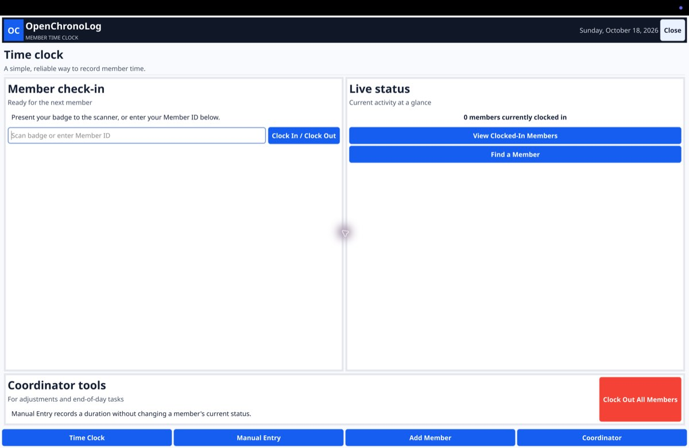

# OpenChronoLog

OpenChronoLog is a desktop time clock for volunteer groups and small workplaces. Members can clock in with a badge or member ID, while coordinators can manage the member list, correct records, review anomalies, and export time reports. The application is written in Go with [Fyne](https://fyne.io/) and runs locally without a server or account.



## Get the app

Download a packaged build from [GitHub Releases](https://github.com/skellywampus/OpenChronoLog/releases). The releases currently published there are for the previous Python application; do not mistake those assets for Go builds. The Go rewrite is being prepared for a separate release. Once published, its downloads will be named:

- **macOS (Apple silicon):** `OpenChronoLog-macos-arm64.zip`. Unzip it and move `OpenChronoLog.app` to Applications or another convenient location.
- **Windows (64-bit):** `OpenChronoLog.zip` (recommended) or `OpenChronoLog.exe`. Extract the ZIP before running the app.

Use these Go-specific assets from the Go release, not the similarly named assets on older Python releases. macOS may ask you to confirm opening an app downloaded from the internet. Only download release files from this repository.

## Features

- Badge scanner and case-insensitive member ID check-in/check-out
- Live view of currently clocked-in members and member lookup
- Coordinator tools to add members, review and edit scan history, and reconcile time
- Manual time entries that record duration without changing clock-in status
- Anomaly detection and correction for unusually long sessions
- CSV export of scan history and date-range time summaries
- Local JSON storage, with interrupted-write recovery
- Kiosk-friendly fullscreen mode: press `F11` to toggle fullscreen and `Escape` to leave it

## First run and data

Keep the app's data files in a writable location. OpenChronoLog reads and writes these JSON files alongside the executable (on macOS, alongside `OpenChronoLog.app`):

| File | Purpose |
| --- | --- |
| `user_database.json` | Member IDs, names, and current status |
| `scan_log.json` | Clock-in/out and manual time records |
| `anomalies_approvals.json` | Anomaly review and correction state |

For a fresh installation, copy the starter files from [`data-template/`](data-template/) to the app's data folder. Keep backups of these files: they contain the local operational records. Do not put real member data in source control or share it publicly.

Use the **Coordinator** area to add members. Member IDs should match the values encoded on badges; IDs are unique and matched without regard to letter case. For USB barcode scanners that act like a keyboard, focus the member ID field and scan the badge.

## Build from source

Requirements:

- Go (version specified by [`go.mod`](go.mod))
- The platform's native Fyne build dependencies; see [Fyne's installation guide](https://docs.fyne.io/started/)
- For Windows cross-builds on macOS or Linux: Docker and [`fyne-cross`](https://github.com/fyne-io/fyne-cross)

Run the app or build for the current platform:

```sh
go run .
go build -o OpenChronoLog .
```

Package Apple silicon macOS or 64-bit Windows builds using the provided Makefile:

```sh
make darwin-arm64
make windows-amd64
```

The macOS app bundle is written under `dist/darwin-arm64/`; Windows artifacts are written under `dist/windows-amd64/`. Build outputs and live data are intentionally not tracked in Git.

## Releases

See [all releases and downloads](https://github.com/skellywampus/OpenChronoLog/releases). The Go release should attach the macOS Apple-silicon ZIP and Windows 64-bit ZIP/EXE together so both platforms are available from the same release. The older Python releases remain available for users of the previous application.

## License

See [`LICENSE`](LICENSE).
